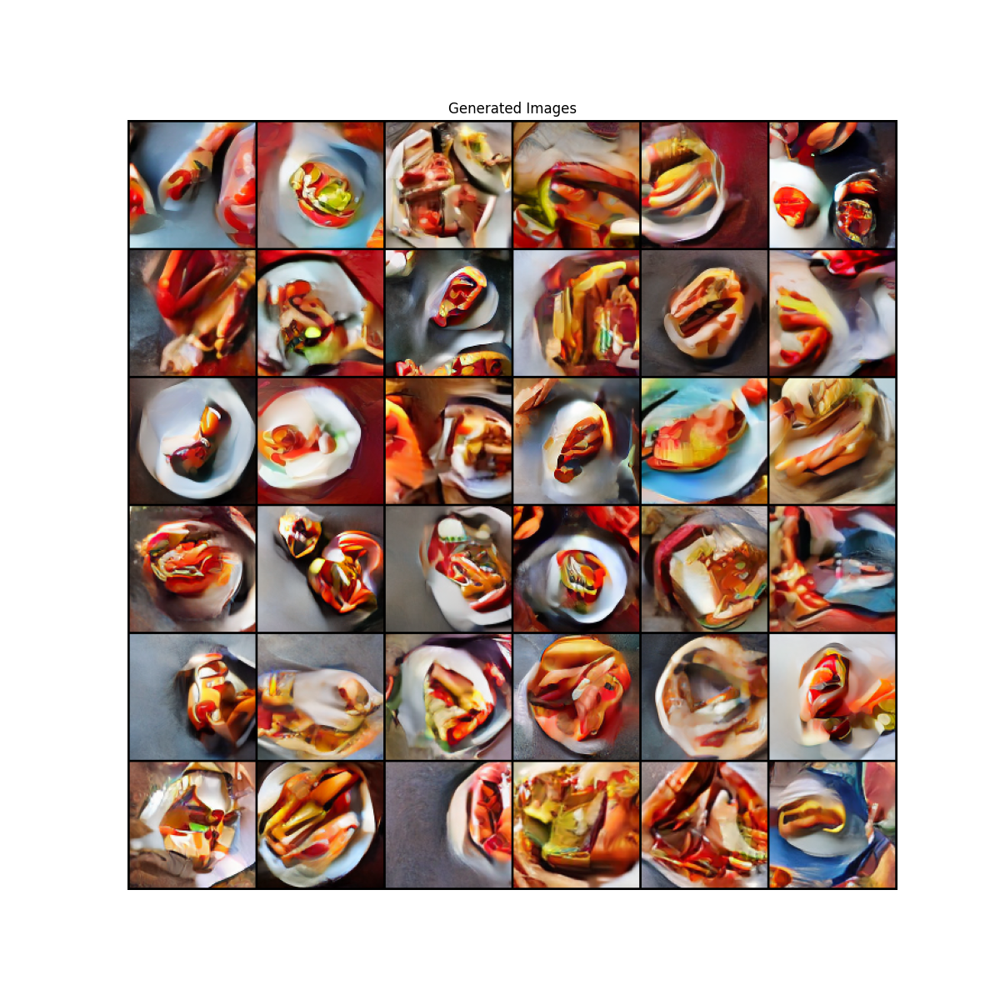
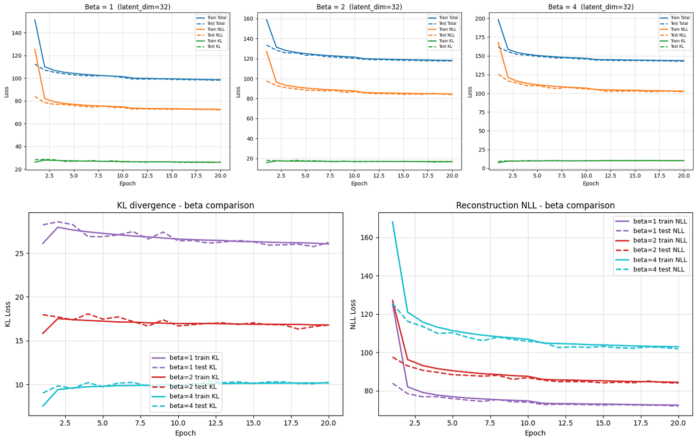
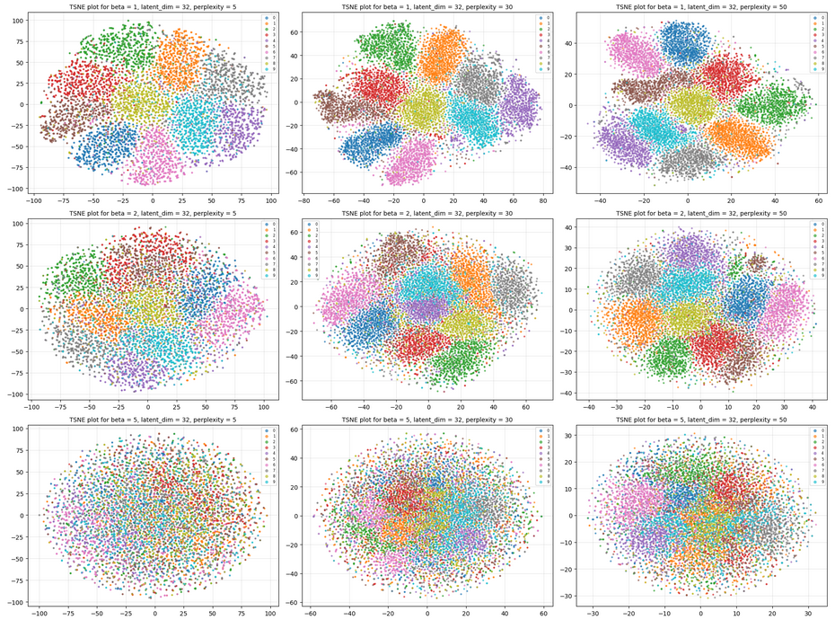
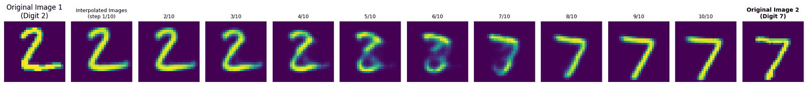

# Deep Learning: Generative Models for Hot-Dog Image Generation With VAE And Latent Diffusion


Variational autoencoders and a latent diffusion model for image generation, built in PyTorch. A DDPM is trained in the latent space of a pretrained Stable Diffusion VAE to generate hot-dog images, which are scored with a Food-101 hot-dog classifier. Deep Learning module, MSc Computing (Artificial Intelligence & Machine Learning), Imperial College London, 2026.

## Overview

```
image ──► Stable Diffusion VAE encoder ──► latent (4×14×14) ──► DDPM (U-Net noise predictor)
                                                                        │
generated image ◄── Stable Diffusion VAE decoder ◄── denoised latent ◄──┘
```

1. **VAE study on MNIST** – a convolutional β-VAE, the choice of decoder likelihood, the effect of β, latent-space structure and interpolation.
2. **Hot dogs with a plain VAE** – the same model at 28×28 resolution, and why it is not enough.
3. **Latent diffusion** – the pretrained VAE compresses 112×112 images to 4×14×14 latents; a DDPM with a small U-Net is trained on those latents and sampled by iterative denoising.

## Results

### Generated hot dogs



36 samples from the final model (635 training epochs). They reproduce the colours and the plate- and bun-like shapes of the training images but are not photorealistic: the noise predictor is small (14M parameters) and trained from scratch.

### Effect of β in the VAE



| β | Final training loss | Reconstruction (NLL) | KL divergence |
|---|---|---|---|
| 1 | 98.6 | ≈ 73 | ≈ 26 |
| 2 | 118.0 | ≈ 84 | ≈ 17 |
| 4 | 143.7 | ≈ 103 | ≈ 10 |

A larger β pushes the posterior towards the prior: lower KL, higher reconstruction loss. The latent codes follow the same trend (t-SNE of the MNIST latent space, latent size 32, perplexities 5, 30 and 50): digit clusters are well separated for β = 1 and merge towards the prior as β grows.



### Interpolation in latent space



### Why latent diffusion

The pretrained VAE reconstructs hot-dog images faithfully, but decoding latents sampled directly from N(0, I) gives incoherent noise: the decoder was only trained on codes from the aggregated posterior, which differs from the prior, and the 4×14×14 latent has 784 jointly structured dimensions. A diffusion model learns the distribution of latents instead of assuming it is Gaussian.


## Implementation details

| Component | Details |
|---|---|
| VAE (MNIST) | Convolutional encoder (28×28 → 7×7×128), linear heads for mean and log-variance, transposed-convolution decoder with sigmoid output, latent size 32, Bernoulli likelihood |
| Pretrained VAE | Stable Diffusion 2 VAE; 112×112 images ↔ 4×14×14 latents |
| DDPM | T = 1000, linear β schedule from 1e-4 to 0.02, noise-prediction loss, iterative sampling |
| Noise predictor | U-Net, 14.06M parameters: sinusoidal time embeddings, down-sampling path through 128, 256 and 384 channels, bottleneck, up-sampling path with skip connections |
| Training | Adam (learning rate 1e-4, cosine annealing), gradient clipping at 1.0, EMA of the weights (decay 0.995) for sampling, resumable checkpoints; after every epoch 16 samples are generated and scored with the hot-dog classifier |

## Repository structure

```
├── dl_cw2.ipynb         # VAE, DDPM, U-Net, training and sampling
├── requirements.txt
└── results/             # figures used in this README
```

## Getting started

```bash
pip install -r requirements.txt
jupyter notebook dl_cw2.ipynb
```

- Python 3.10+ and a GPU; the latent diffusion training loop takes several hours.
- The notebook clones the public helper repository [`bkainz/icl_dl_cw2_utils`](https://github.com/bkainz/icl_dl_cw2_utils), which provides the hot-dog dataset class and the hot-dog classifier. MNIST is downloaded automatically.
- If downloading the pretrained VAE requires a Hugging Face login, set the `HF_TOKEN` environment variable. Never store an access token in the notebook.
- Trained weights are not stored in the repository because of their size.
